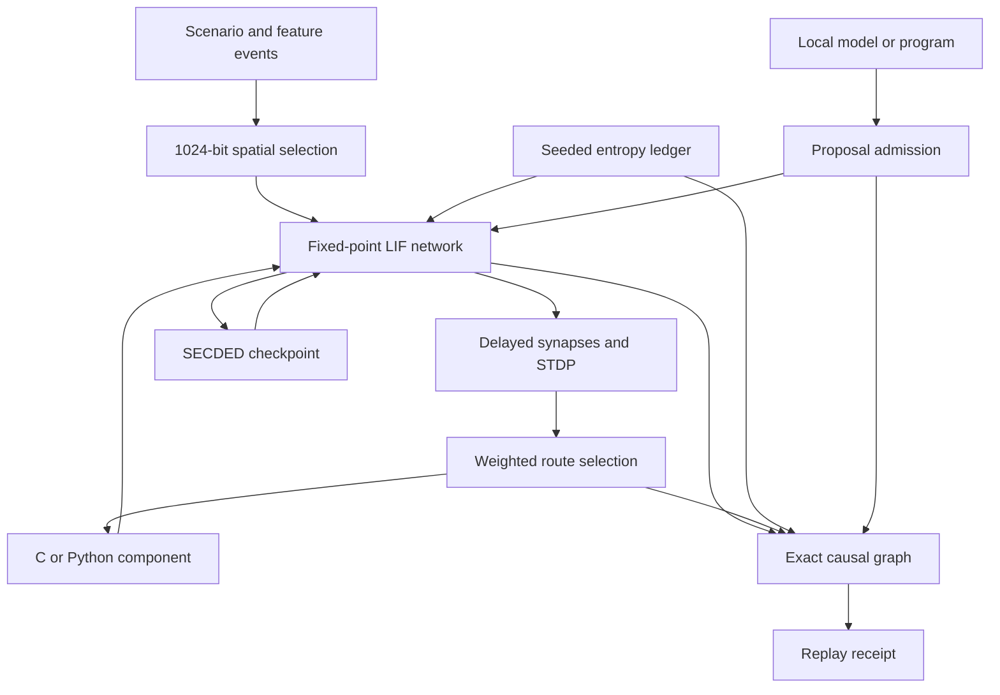

# NeuroMantle

    

A deterministic spiking network with a C11 simulation core, weighted routing and 1024-bit similarity input, backed by exact causal event records and seeded entropy. The command also exposes the supplied developer CLI, Vanta compiler and Surreal proof tools through separate, explicit entry points.



The C hot path calculates every neuron transition, delayed delivery and plasticity update. A single ordered scheduler makes simultaneous spikes deterministic. Exact rational arithmetic checks candidate plasticity transitions in ten-tick batches, and incremental SHA-256 state roots, a causal graph and a seeded entropy ledger form the receipt path. Routing and spatial search use the supplied NeuroRoute code. A weighted route can invoke a bound C or Python executable and inject its computed current on the next tick. Every tick records before/after roots, spike routing, module output, causal parent and entropy root. A refusal also has a replayable receipt.

## Build and use

Requires a C11 compiler, a C++23 compiler, Python 3 and Make. On Linux x86-64, the bundled Vanta and Surreal command tools can also run.

Start with the [step-by-step guide](docs/GETTING_STARTED.md). The [C API reference](docs/C_API.md), [command and process ABI](docs/API_ABI.md), and [system interface map](docs/SYSTEM_INTERFACE.md) describe the public functions, executable contracts and operating system interactions.

```sh
make -j2
make test
./bin/neuromantle run examples/two_neuron.nm run.receipt
./bin/neuromantle verify examples/two_neuron.nm run.receipt
./bin/neuromantle dev status
./bin/neuromantle compile-vanta vendor/vanta/examples/heterogeneous.vnt heterogeneous
./heterogeneous
./bin/neuromantle surreal qec-describe
./bin/neuromantle ai-run examples/two_neuron.nm examples/ai/local_policy.py ai.receipt
./bin/neuromantle ai-verify examples/two_neuron.nm ai.receipt
./bin/neuromantle ai-verify-live examples/two_neuron.nm ai.receipt
./bin/neuromantle run examples/ecc.nm ecc.receipt
```

`run` exits 0 for admission and 3 for a refused scenario, writing a receipt in either case. `verify` independently reruns the scenario and checks the entire receipt byte for byte. The input and its execution environment are trusted for replay; a receipt is a reproducibility and tamper detection record, not an unforgeable attestation or formal proof of an arbitrary module.

A local model can propose bounded stimuli through an executable adapter. `ai-run` records its exact output and runs the proposed scenario through the ordinary admission engine. `ai-verify` replays the recorded output without model inference; `ai-verify-live` also repeats inference and requires identical output. The included executable policy demonstrates the protocol with real computed input. [Protocol and model setup](docs/AI_PROTOCOL.md) and [API and ABI](docs/API_ABI.md) specify every public call and process frame.

An optional software SECDED checkpoint corrects one flipped bit per encoded word and detects two. A separate admission gate verifies a supplied five-qubit QECC certificate with Surreal. [ECC semantics and runnable example](docs/ECC.md) distinguish classical state protection from the quantum-code proof.

## Process isolation and measured performance

Module, local adapter and QECC verifier children install a fail-closed Linux seccomp policy before execution. The policy denies filesystem mutation, socket creation and process creation. `ai-run-socket` grants one explicitly connected local Unix stream to an adapter. It does not hide files the caller can read; [sandbox details](docs/SANDBOX.md) describe the exact boundary and adversarial tests.

On the measured Xeon virtual machine, a 1,024-neuron, four-synapse-per-neuron workload reached 29,699 to 48,057 native core ticks/s. Full CLI receipt generation reached 567 to 2,214 ticks/s, depending on spike density. Including a separate receipt replay gave 286 to 1,107 verified tick operations/s (vTOS). These are separate measurements, not a promise for other hardware or a comparison with another simulator. [Methods and raw timings](docs/BENCHMARKS.md) include all cases and repeat measurements.

## Dynamics

Each configured neuron has membrane voltage, reset and threshold values, a Q16.16 leak factor and a refractory duration. Tick `t` computes `reset + trunc((voltage - reset) × leak / 65536) + scheduled_input`; reaching threshold emits one spike and resets the neuron. Edges deliver their old signed weight after an integer delay. Pair timing updates weights with a bounded linear STDP window: a post spike after a pre spike potentiates, and a pre spike after a post spike depresses. Pair timing uses previous timestamps, so same-tick spikes do not pair with each other. The resulting weight updates the corresponding weighted router road before route selection. Negative weights inhibit the destination neuron but contribute zero to the router's positive selection score.

The scheduler commits all neuron, edge and delay queue changes together. Checked integer overflow refuses the tick without partial core state mutation. One source spike fans out through every configured synapse; the weighted router chooses a single event destination for the route trace. The spatial pool resolves a 1024-bit feature vector by exact Hamming distance, with the first configured minimum winning.

## Repository map

| Path | Working role |
| --- | --- |
| `core/`, `include/` | C11 neuron and synapse engine and public API |
| `src/` | Scenario admission, causal receipts and command integration |
| `vendor/neuroroute/` | Spatial pool and updated weighted router source |
| `vendor/surreal/` | Built exact/causal/entropy subset plus the complete supplied source and tools under `upstream/` |
| `vendor/devcli/` | Developer toolchain front door |
| `vendor/vanta/` | Native compiler and source-to-C crosspiler |
| `tests/`, `evidence/` | Executable checks and recorded results |

The upstream Surreal command retains its own admission, rewrite and QECC operations. Those operations are invoked explicitly through `neuromantle surreal`; QECC does not protect the classical spike state. DevCLI builds language projects, and an explicitly bound executable participates in the routed event protocol. The Vanta compiler builds standalone programs and is not represented as a substitute for the C11 SNN core.

See [model and scenario format](docs/MODEL.md), [state commitments and exact audit](docs/STATE_COMMITMENTS.md), [receipts and trust boundaries](docs/VERIFICATION.md), [integration details](docs/ARCHITECTURE.md), [research references](docs/REFERENCES.md), [component provenance](docs/PROVENANCE.md), and [test evidence](evidence/RESULTS.md).
