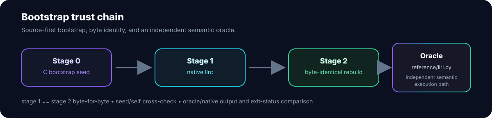

<p align="center">
  
</p>

<p align="center">
  
  
  
  
  
</p>

<p align="center">
  <strong>A deliberately small native language whose compiler, bootstrap path, semantic oracle, and release evidence are designed to stay readable.</strong>
</p>

LLRLANG is a small self-hosting native systems language and compiler. The compiler is written in LLRLANG, emits Linux x86-64 ELF executables directly, and does not invoke a C compiler, assembler, linker, or code generator after the bootstrap seed has produced stage 1.

> [!NOTE]
> LLRLANG 0.x is intentionally narrow. The project optimizes for a compact trust chain, explicit semantics, reproducible native artifacts, and evidence that can be audited without a large external toolchain.

## At a glance

| | |
| --- | --- |
| **Release** | `0.5.0` |
| **Target** | Linux x86-64 |
| **Compiler source** | [`compiler/llrc.llr`](compiler/llrc.llr) |
| **Bootstrap seed** | [`bootstrap/llrc_stage0.c`](bootstrap/llrc_stage0.c) |
| **Semantic oracle** | [`reference/llri.py`](reference/llri.py) |
| **Runtime model** | direct Linux syscalls + source-linked LLRLANG standard-library modules |
| **License** | MIT |

## Why it exists

LLRLANG is an experiment in making a native compiler whose complete trust chain can be read and reasoned about directly: a compact C seed, a self-hosted compiler written in LLRLANG, and a release gate that rebuilds the system from source and refuses to ship unless the compiler reproduces itself byte for byte.

It is aimed at people interested in:

- bootstrappable and reproducible builds;
- small auditable compiler implementations;
- direct native code generation without an assembler/linker step after bootstrap;
- explicit runtime and memory boundaries;
- independent semantic cross-checking rather than compiler self-agreement alone.

It is **not** trying to be a general-purpose language in the 0.x series. Keeping the language small is part of the engineering constraint.

## Quick start

On Linux x86-64, use the included self-hosted compiler directly:

```sh
./bin/llrc-linux-x86_64 examples/hello.llr -o hello
./hello
```

Expected output:

```text
hello from LLRLANG
```

Rebuild the compiler from the C seed and verify self-reproduction:

```sh
make bootstrap
```

Run the full release gate:

```sh
make check
```

Create the deterministic release ZIP:

```sh
make release
```

## Bootstrap and verification model

<p align="center">
  
</p>

The C seed exists only to break the bootstrap cycle. It produces the first native compiler; the continuing implementation is the LLRLANG compiler source itself.

```text
llrc_stage0.c -> stage0 -> compile llrc.llr -> stage1 -> compile llrc.llr -> stage2
                                               stage1 == stage2 byte-for-byte
```

Byte-identical stage 1 and stage 2 prove that the compiler **reproduces itself**. They do not, by themselves, prove semantic correctness. LLRLANG therefore also uses an independent reference interpreter written from the language reference and sharing no code with the compilers.

The retained 0.5.0 validation evidence records:

| Gate | Retained result |
| --- | --- |
| GCC/Clang cross-seed artifact identity | SKIP on retained host (`clang` unavailable) |
| Stage 1 / stage 2 reproduction | byte-identical |
| C seed ASan/UBSan checks | PASS |
| Positive executable fixtures | 24 cases, PASS |
| Negative compiler corpus | 25 cases, identical diagnostics |
| Runtime trap matrix | 13 cases |
| Oracle/native comparisons | PASS |
| Oracle execution of the compiler itself | byte-identical stage 2 |
| Bounded arithmetic checks | 16,320 + 2,048 shift cases |
| Differential corpus | 256 cases |
| Repeated self-compilation | 20 runs, 1 unique artifact |
| Final retained validation state | `FINAL_VALIDATION_PASS` |

See [`evidence/VALIDATION_SUMMARY.txt`](evidence/VALIDATION_SUMMARY.txt) for the exact retained output and [`docs/TESTING.md`](docs/TESTING.md) for the test model.

For a copy-and-paste installation, compilation, test, and release walkthrough, see [`HOW_TO_RUN.md`](HOW_TO_RUN.md).


## Retained 0.4.0 optimizer

0.5.0 retains the 0.4.0 direct-ELF optimizations without widening their proof boundary.

1. **Immediate RHS lowering.** Arithmetic, bitwise, and comparison forms with a signed 32-bit literal on the right are emitted with AMD64 immediate instructions rather than the generic push/pop expression shuttle. Checked overflow behavior is preserved.
2. **Proven constant affine-loop folding.** A narrow counted recurrence of the form `x = (a*x + c) & mask`, with constant initial state, constant limit, unit induction step, power-of-two mask, and a proven non-overflow bound, is evaluated by affine exponentiation during compilation. The source loop disappears from the executable. Any loop that does not satisfy every proof condition falls back to normal native code generation.

There is still no general optimizing IR, SSA pass, register allocator, vectorizer, or speculative optimizer. See [`docs/OPTIMIZATION_0_4.md`](docs/OPTIMIZATION_0_4.md).

### Retained local performance observation

The 0.5.0 release gate requires the optimized 20,000,000-step affine executable to remain byte-identical to 0.4.0 (`f3d9b261...e999`, 4,253 bytes), then measures it again on the current host. This is a bounded result for the optimizer's recognized domain, not a claim that LLRLANG is universally faster than Clang.

Run the reproducible local comparison with:

```sh
make perf
```

See [`evidence/performance/PERFORMANCE_REPORT.md`](evidence/performance/PERFORMANCE_REPORT.md).

## Language snapshot

```lisp
(fn factorial (n)
  (if (<= n 1)
    (block (return 1))
    (block (return (* n (call factorial (- n 1)))))))

(fn main (argc argv)
  (return (- (call factorial 5) 120)))
```

The language is intentionally compact. Values are signed 64-bit machine words; strings are NUL-terminated byte sequences; functions accept at most six parameters; and explicit low-level memory and syscall forms are available.

The normative contract lives in [`docs/LANGUAGE_REFERENCE.md`](docs/LANGUAGE_REFERENCE.md).

## What is shipped

- complete native compiler source in LLRLANG;
- auditable C stage-zero source seed;
- deterministic stage-1/stage-2 self-reproduction;
- direct ELF64 x86-64 backend;
- checked signed arithmetic traps for overflow, division edge cases, and invalid shifts;
- raw low-level byte/word memory primitives plus a bounds-checked managed-region library;
- native I/O and process/pipe library modules;
- positive, negative, runtime-trap, byte-domain, bounded arithmetic, differential, reproducibility, and cross-seed tests;
- positional diagnostics (`file:line:col`) checked for seed/self identity;
- independent reference interpreter used as a semantic oracle;
- prebuilt self-hosted Linux x86-64 compiler with a SHA-256 manifest;
- bootstrap, ABI, runtime, memory, testing, security, and release documentation.

## Diagnostics

Compile errors are reported as:

```text
llrc: FILE:LINE:COL: error: MESSAGE
```

and exit with status `2`. Multi-file errors are attributed to the source file and position where they occur. The C seed and self-hosted compiler are required to produce identical diagnostics on the negative corpus.

```text
$ ./bin/llrc-linux-x86_64 broken.llr -o broken
llrc: broken.llr:3:12: error: unknown form
```

## Runtime and memory boundary

Generated executables are self-contained ELF files with a non-executable process stack and no dynamic interpreter. There is no garbage collector or hidden runtime process.

Raw `load8`, `load64`, `store8`, and `store64` forms are unsafe by construction. Code that needs checked memory access should use [`stdlib/memory.llr`](stdlib/memory.llr), which validates managed-region bounds before access.

> [!IMPORTANT]
> This release does **not** claim universal memory safety, formal verification, portability beyond the listed target, or exhaustiveness over the infinite set of possible programs. Verification claims are limited to the documented bounded domains and reproducibility properties.

See [`docs/MEMORY_AND_SAFETY.md`](docs/MEMORY_AND_SAFETY.md) and [`docs/IMPLEMENTATION_STATUS.md`](docs/IMPLEMENTATION_STATUS.md).

## Repository layout

The source tree is organized by responsibility rather than by build chronology:

```text
LLRLANG/
├── compiler/          # self-hosted compiler source
├── bootstrap/         # minimal C stage-zero source seed
├── stdlib/            # source-linked runtime support
├── reference/         # independent semantic oracle
├── examples/          # small runnable programs
├── tests/             # positive, negative, and runtime fixtures
├── scripts/           # bootstrap, verification, reproducibility, release
├── docs/              # specification and engineering documentation
├── evidence/          # retained release-gate output
├── third_party/       # attributed xAI/Grok reference reading, not release authority
├── bin/               # prebuilt Linux x86-64 compiler
├── assets/            # GitHub README graphics
└── .github/           # CI and contribution templates
```

For a deliberate documentation reading order, start at [`docs/README.md`](docs/README.md).

## Documentation

| Topic | Document |
| --- | --- |
| Language specification | [`docs/LANGUAGE_REFERENCE.md`](docs/LANGUAGE_REFERENCE.md) |
| Compiler architecture | [`docs/COMPILER_ARCHITECTURE.md`](docs/COMPILER_ARCHITECTURE.md) |
| Bootstrap trust chain | [`docs/BOOTSTRAP.md`](docs/BOOTSTRAP.md) |
| ABI | [`docs/ABI.md`](docs/ABI.md) |
| Runtime | [`docs/RUNTIME.md`](docs/RUNTIME.md) |
| Memory & safety | [`docs/MEMORY_AND_SAFETY.md`](docs/MEMORY_AND_SAFETY.md) |
| Testing | [`docs/TESTING.md`](docs/TESTING.md) |
| Implementation status | [`docs/IMPLEMENTATION_STATUS.md`](docs/IMPLEMENTATION_STATUS.md) |
| Release process | [`docs/RELEASE_PROCESS.md`](docs/RELEASE_PROCESS.md) |

## Release integrity

`SHA256SUMS.txt` covers release files intended to remain immutable between regeneration steps. `make check` rebuilds the compiler rather than trusting the prebuilt binary, while `make release` performs a fresh gate before deterministic packaging.

Repository text files are pinned to LF through [`.gitattributes`](.gitattributes) so Git checkouts do not silently rewrite release inputs across platforms.

## Contributing and security

Read [`CONTRIBUTING.md`](CONTRIBUTING.md) before changing compiler semantics or release gates. Security-relevant compiler, bootstrap, ELF, trap, or managed-region issues should follow [`SECURITY.md`](SECURITY.md).

## Citation

Machine-readable citation metadata is available in [`CITATION.cff`](CITATION.cff).

## License

MIT © 2026 Alexandru Moraru. See [`LICENSE`](LICENSE).
