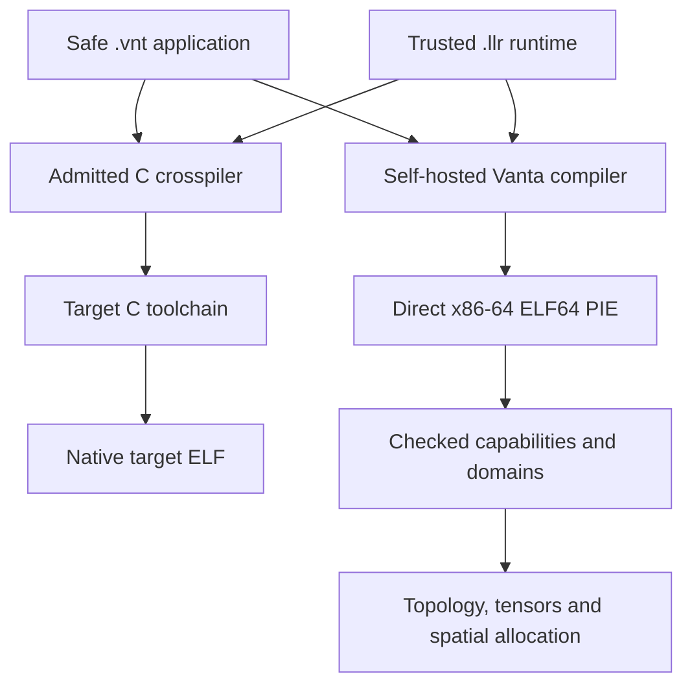
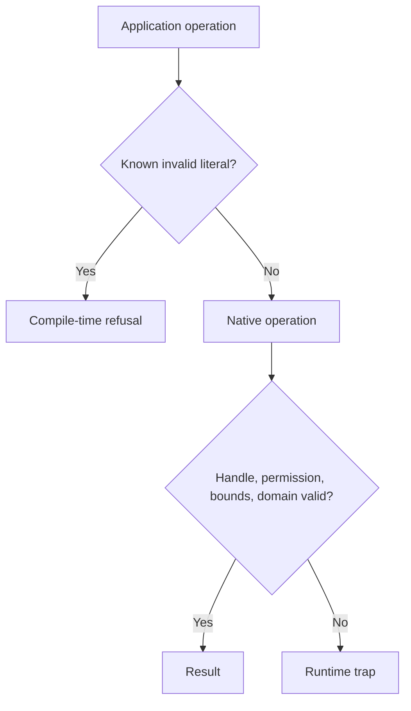

# Vanta Native 1.2.1

   

Vanta Native has a self-hosting direct x86-64 compiler implemented in **LLRLANG** and a separate source-to-C crosspiler. The crosspiler lowers the same trusted runtime modules and safe application source to native C operations, then uses a target GCC toolchain. The C stage-zero seed remains the only handwritten C implementation source in the direct compiler trust chain.

The compiler emits Linux x86-64 ELF64 PIE executables directly. After bootstrap it does not invoke an assembler, linker, JIT, foreign compiler, or hidden secondary implementation.

## Execution path



## Trust chain

```text
bootstrap/llrc_stage0.c
        |
        v
  stage-zero llrc
        |
        v
bootstrap/llrc.llr  --> self-hosted LLRLANG compiler
        |
        v
compiler/vantac.llr --> Vanta transition stage
        |
        v
    Vanta stage 2
        |
        v
    Vanta stage 3  == byte-identical fixed point
        |
        v
 .vnt application + trusted .llr runtime --> native ELF64 executable
```

`.vnt` is the safe application surface. The compiler rejects raw memory forms, raw syscalls and direct calls into the reserved runtime namespace from `.vnt`. Trusted implementation modules use `.llr` and form the explicit unsafe boundary.

## Capability admission



Compile-time checks are conservative. Runtime validation remains authoritative for computed values.

## Implemented architecture

### Compiler and bootstrap

- source-to-C crosspilation of the same trusted LLRLANG runtime and safe application syntax;
- explicit left-to-right lowering, checked integer arithmetic, Linux syscall mapping, and native target ABI through the target C compiler;
- differential execution gate and an AArch64 native runner workflow;
- direct Linux x86-64 PIE ELF64 code generation;
- no assembler or linker after the bootstrap seed;
- byte-identical Vanta stage-2/stage-3 self-host fixed point;
- GCC and Clang stage-zero convergence gate for byte-identical LLRLANG and Vanta compilers;
- ASan/UBSan gate on the only C implementation source;
- multi-file safe application compilation;
- ten-run byte-identical application output gate.

### Safe execution model

- compiler rejection of raw loads/stores, raw syscalls and reserved runtime calls in `.vnt`;
- compiler-side static tags for known scalar/resource kinds;
- opaque resource tokens with a slot plus **kernel-random 47-bit generation nonce**;
- runtime kind+nonce validation on every resource dereference;
- deterministic stale-handle and forged-token rejection;
- automatic exit-time live-resource audit;
- checked signed `i64` arithmetic plus explicit `wrap+`, `wrap-`, `wrap*` modulo operations.

### Memory and topology

- bounded capability memory;
- independent read/write/transfer permissions;
- monotonic sub-capabilities that cannot widen parent bounds;
- sealed read-only capabilities;
- capacity-accounted memory domains;
- topology visibility checks on safe memory/tensor/container access;
- directed transfer fabrics;
- deterministic O(N²) shortest-route evaluation over the fixed domain set;
- routed memory/tensor transfer with destination capacity admission;
- logical topology execution through `on-call`.

### Numerics and compute

- explicit MXCSR `0x1f80` installation in direct generated executables, and AArch64 FPCR/FPSR initialization in crosspiled executables;
- native scalar IEEE-754 binary64 add/sub/mul/div;
- ordered comparisons with explicit unordered/NaN behavior;
- binary64 sqrt, abs, negation and `isnan`;
- no implicit FMA contraction in the implemented binary64 forms;
- dense rank-2 signed-i64 and binary64 tensors;
- checked i64 matrix multiplication;
- native binary64 matrix multiplication;
- forward-mode binary64 autodiff with dual-number resources.

### Native standard library

- safe text handles;
- capability-buffered file read/write;
- dynamic capability-backed `i64` vectors;
- deterministic open-addressed `i64 -> i64` hash maps with checked growth;
- FNV-1a capability hashing for non-cryptographic use;
- native SHA-256 over capability memory with known-vector tests;
- exact 1024-bit spatial key matching to configured memory domains, deterministic tie resolution, and capacity-accounted allocation;
- integer/text output utilities.

## Build from the seed

```bash
./scripts/bootstrap.sh
```

The first Vanta generation is a transition compiler. The release proof is the correct self-hosting fixed point: **Vanta stage 2 must equal Vanta stage 3 byte-for-byte**.

## Crosspiled native build

```bash
python3 crosspiler/vantax.py examples/heterogeneous.vnt -o heterogeneous-port
./heterogeneous-port
```

`--emit-c program.c` emits an admitted C source file for a target toolchain. Admission uses the bundled direct compiler on x86-64; build the admitted C on an AArch64 Linux target with `cc -std=gnu11 -O2 program.c -lm -o program`. The CI workflow builds and runs the admitted suite on an AArch64 runner. See [`docs/CROSSPILER.md`](docs/CROSSPILER.md).

## Full release gate

```bash
make check
```

This executes bootstrap fixed-point verification, C-seed ASan/UBSan, GCC/Clang diverse-seed convergence, the direct native suite, generated-ELF hardening checks, and source-tree hygiene checks. `make cross-check` compares native executions from both backends. CI additionally compiles and executes admitted programs on AArch64.

The native suite includes positive programs, compiler refusals, runtime traps and a ten-run reproducibility check. Run `make check` on Linux x86-64 with GCC, Clang and sanitizer support for the complete gate.

## Compile a program

```bash
./bin/vantac-linux-x86_64 \
  stdlib/kernel.llr \
  stdlib/memory.llr \
  stdlib/topology.llr \
  stdlib/tensor.llr \
  stdlib/io.llr \
  stdlib/hash.llr \
  stdlib/autodiff.llr \
  stdlib/text_io.llr \
  stdlib/vector.llr \
  stdlib/map.llr \
  stdlib/sha256.llr \
  stdlib/spatial.llr \
  examples/heterogeneous.vnt \
  -o heterogeneous

./heterogeneous
```

Expected output:

```text
19
22
43
50
50
```

## Static admission

Known invalid literal values are rejected during compilation: domain IDs and capacities, allocation sizes and permissions, tensor and vector sizes, transfer costs, SHA-256 word indices and negative capability offsets. Values computed at runtime continue through the corresponding runtime checks. The compiler does not infer full tensor shapes, capacity across arbitrary control flow, or hardware execution from source declarations.

## Safety boundary

Vanta does **not** claim that arbitrary trusted `.llr` implementation code is memory-safe. The narrower `.vnt` safety boundary is executable and testable:

- raw memory and raw syscalls are not expressible through accepted safe forms;
- application-visible resources are opaque non-pointer tokens;
- tokens use randomized generation nonces and runtime kind validation;
- capability bounds, permissions and topology visibility are rechecked at use;
- root/sub-capability lifetime rules prevent silent stale reuse;
- successful program exit is audited for leaked live resources.

Renaming untrusted source to `.llr` is an explicit opt-out into the trusted/unsafe implementation boundary.

## Platform scope and non-claims

The direct ELF backend is Linux x86-64. The source-to-C backend targets Linux x86-64 and AArch64 through the target C compiler; the local differential evidence is x86-64, and AArch64 executable verification is configured in CI. Crosspilation uses a target compiler and linker. `on-call` provides enforced logical topology context; it is not presented as physical GPU/accelerator dispatch. This release does not claim formal compiler proof, side-channel resistance, kernel isolation, or memory safety for trusted `.llr` code.

Those limits are stated deliberately; features not implemented are not represented as implemented.

## Documentation

- [`docs/ARCHITECTURE.md`](docs/ARCHITECTURE.md)
- [`docs/LANGUAGE.md`](docs/LANGUAGE.md)
- [`docs/ABI.md`](docs/ABI.md)
- [`docs/SECURITY.md`](docs/SECURITY.md)
- [`docs/VALIDATION.md`](docs/VALIDATION.md)
- [`docs/DESIGN_RATIONALE.md`](docs/DESIGN_RATIONALE.md)
- [`docs/SPATIAL.md`](docs/SPATIAL.md)
- [`docs/PORTABILITY.md`](docs/PORTABILITY.md)
- [`docs/CROSSPILER.md`](docs/CROSSPILER.md)
- [`docs/REFERENCES.md`](docs/REFERENCES.md)
- [`CHANGELOG.md`](CHANGELOG.md)
